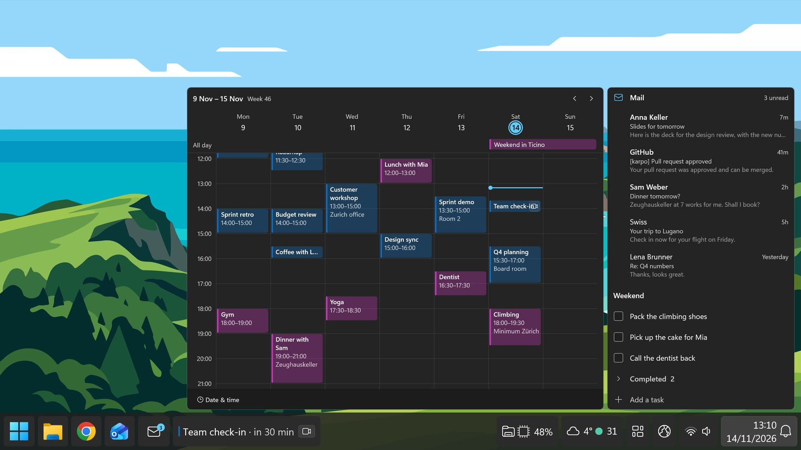

# Karpo

**The Windows taskbar, with your day in it.** · [karpo.app](https://karpo.app)

Karpo is a taskbar for Windows 11 and 10 that looks just like the one Windows comes with. The
difference: your next meeting, your newest emails, the weather, your music and how hard your PC is
working sit right beside your apps, and every one of them opens with a click.

- **Your day**: the next meeting with a countdown and a join button, new mail, your whole week in one click
- **More than a hundred widgets**: weather, music, live graphs for your PC, clocks, timers, stocks, feeds, files
- **Folders** that open as your own little dashboard, and **layouts** for work, the evening and focus
- **Every screen, any edge**: bottom, top, left or right, each with its own layout
- **Yours to arrange**: right-click, Edit, and drag things where you want them, right on the taskbar
- **Private**: no ads, no tracking, no account; it only reads your mail and calendar, and your data stays on your PC
- **Light**: there a fraction of a second after it starts, and easy on memory and battery

Works with Microsoft accounts, any IMAP mailbox (Gmail, iCloud and the rest), and CalDAV and CardDAV. In 40 languages.

**Free to start.** Every widget and every setting is in the free version, with up to 20 widgets per
layout and 2 layouts. Karpo Pro, one purchase in the Microsoft Store, lifts both for good. Karpo is on
its way to the Store; [karpo.app](https://karpo.app) tells you the day it lands.

---

Source under the [Elastic License 2.0](LICENSE) · [Build it](docs/development.md) ·
[Work on it](CONTRIBUTING.md) · Made by [Lometics](https://lometics.com)
