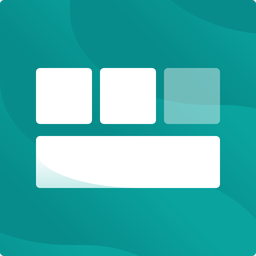

# Karpo logo

The mark is `karpo.svg`, a vector: Lometics' square (its small corners, its folds, its white
cards) in Karpo's teal `#0AA39E`, carrying three tiles over a long bar. It fills its square to
the edge. Every other file here is drawn from it: headless Chrome draws the vector large and
each size is resampled from that; up to 48 px the tiles and the bar are drawn on whole pixels
over the resampled square, so a taskbar icon's edges are sharp.

## Files

| File               | What it is                                            | Used by                                            |
| ------------------ | ----------------------------------------------------- | -------------------------------------------------- |
| `karpo.svg`        | the master                                            | the source of the rest; the Store pages            |
| `karpo-<size>.png` | 16, 20, 24, 32, 40, 48, 64, 128, 256, 512 and 1024 px | `karpo-64.png`: ⚙'s rows; `karpo-128.png`: README  |
| `karpo.ico`        | 16, 20, 24, 32, 40, 48, 64 and 256 px                 | the exe's icon                                     |

`Karpo.Dock.csproj` takes `karpo.ico` as the exe's icon and holds `karpo-64.png` inside the exe.
